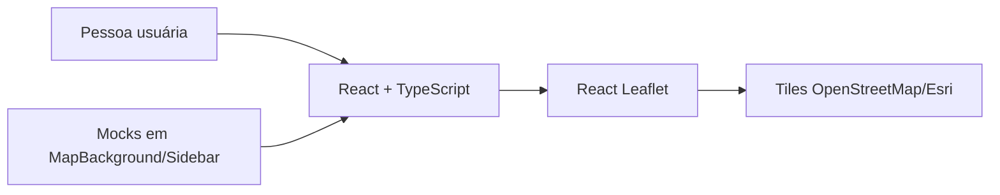
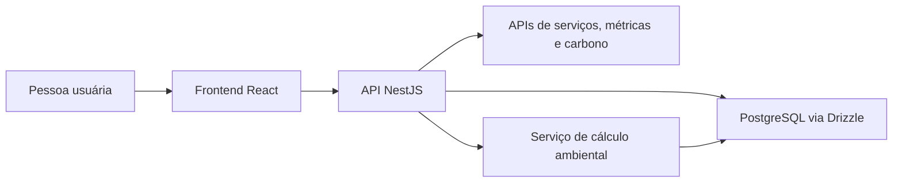

# Arquitetura

## Arquitetura existente na Sprint 1

O único fluxo executável é o protótipo frontend. Os dados estão definidos em arrays TypeScript e não atravessam backend ou banco.

| Componente | Estado |
|---|---|
| React/Vite | Executa em desenvolvimento |
| Componentes do dashboard | Implementados como protótipo |
| Leaflet | Integrado a tiles públicos e marcadores simulados |
| NestJS | Dependências/configuração; arquivos funcionais vazios |
| Drizzle | Configuração inicial; schemas/provider vazios |
| PostgreSQL | Imagem declarada; sem modelo/migração/dados |
| Docker Compose | Inválido e sem serviço de backend |

## Arquitetura-alvo planejada

O diagrama abaixo é direção de produto, não entrega da Sprint 1.

## Decisões observáveis

- frontend e backend usam TypeScript;
- React/Vite compõe a interface;
- NestJS foi escolhido para a API;
- PostgreSQL e Drizzle ORM foram escolhidos para persistência;
- Leaflet foi escolhido para mapa;
- Docker foi escolhido para empacotamento.

Essas escolhas não significam que todas as camadas estejam integradas.

## Dívidas que bloqueiam a integração

1. inicializar `main.ts` e `app.module.ts` e implementar módulos mínimos do NestJS;
2. compatibilizar TypeScript e Nest CLI;
3. definir contratos das APIs externas;
4. modelar schemas e migrações;
5. remover mocks do fluxo integrado;
6. corrigir o Compose, incluir backend e usar variáveis sem segredo;
7. adicionar testes e pipeline de validação.
