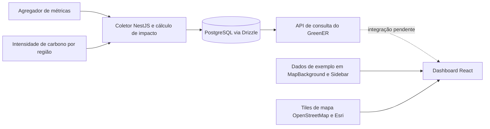

# Arquitetura do GreenER

Em 06/11/2026, o backend da `main` descobriu serviços nas APIs da UniLaunch, gravou medições no PostgreSQL e respondeu à consulta do dashboard. O frontend abriu no navegador com os dados de exemplo definidos nos componentes React. A ligação entre a tela e a API é a principal integração pendente da Sprint 2. [Código avaliado em `1e075b9`](https://github.com/404NotFound-ABP/greener/tree/1e075b9d2d0a0e2b8dbe396c6121a56057cbc4e1)

## Caminho dos dados

1. O coletor inicia um ciclo na partida do NestJS e agenda outros a cada 30 segundos. Um controle em memória impede a sobreposição de ciclos na mesma instância.
2. O backend sincroniza as regiões e consulta os serviços presentes no agregador. Para cada serviço, busca métricas e fator regional, estima o impacto, atualiza o cadastro e grava uma medição com o horário da coleta. O cálculo usa o intervalo informado pelo agregador em cada leitura.
3. Um serviço ausente de uma descoberta bem-sucedida passa a `removido`. Seu histórico fica no banco. Se o mesmo ID voltar, o coletor reativa o cadastro. Uma falha ao consultar a lista interrompe o ciclo antes de marcar remoções.
4. A API consulta o banco para servir a lista, o resumo do dashboard e o histórico. Outras rotas consultam os provedores em tempo real. O frontend mantém os dados de demonstração na lista, nos marcadores e no modal. [Contratos da API](api.md) · [Estimativa de impacto](calculos.md) · [Interface](interface.md)

## Modelo persistido

| Tabela | Chave e conteúdo |
|---|---|
| `regioes` | `codigo` identifica a região. Armazena país, região, cidade, coordenadas, intensidade de carbono e percentual renovável. |
| `servidores` | `id` identifica o serviço no agregador. Guarda nome, referência à região, caminho de métricas, estado atual, indicador de atividade e datas. |
| `coletas_metricas` | Cada `id` identifica uma leitura vinculada a `servidor_id`. Guarda horário, duração, estado, métricas brutas, potência, energia, fator regional e emissão. Uma falha pode gerar uma leitura com campos nulos. |
| `users` | Identificador, e-mail único, nome, hash da senha, papel e datas de controle. As rotas administrativas da API verificam JWT e papel de administrador. As telas de acesso continuam demonstrativas. |

O Drizzle mantém as definições das tabelas e duas migrações SQL versionadas. O PostgreSQL usa o volume `postgres_data` para preservar os dados entre partidas. [Schemas](../backend/src/database/schema) · [Migrações](../backend/drizzle) · [Docker Compose](../docker-compose.yml)

## Execução e limites da versão

O Compose empacota frontend React/Vite servido pelo Nginx (porta padrão do host `3000`), API NestJS (porta `3001`) e PostgreSQL 16 (porta `5433` no exemplo de ambiente). O backend aguarda o healthcheck do banco. Para preparar uma instalação nova, aplique as migrações conforme o [guia de execução](../README.md).

No teste com volume novo, a interface e o Swagger responderam `200` enquanto a consulta ao dashboard retornou `500` pela ausência da tabela `servidores`. Depois de aplicar as migrações e reiniciar o backend, a API retornou sete serviços, o banco registrou 14 medições e uma leitura conferida permaneceu após o reinício do PostgreSQL. Esses números pertencem à execução de 06/11 e variam com o ambiente do parceiro. [Preparação automática do banco pendente na #155](https://github.com/404NotFound-ABP/greener/issues/155)

## Referência histórica

O relatório da Sprint 1 descreve a versão de 19/10, quando o protótipo React usava dados locais e as demais camadas estavam em preparação. O fluxo acima corresponde à verificação posterior na Sprint 2. [Relatório da Sprint 1](sprints/sprint-1.md) · [Acompanhamento da Sprint 2](sprints/sprint-2.md)
