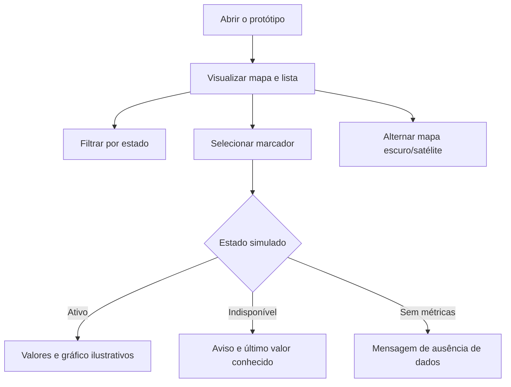

# Interface e experiência de uso

## Perfis e tarefas

| Perfil | Objetivo | Tarefas prioritárias |
|---|---|---|
| Pessoa que acompanha o ambiente | Entender disponibilidade e impacto dos serviços | Localizar serviços; distinguir ativo, indisponível e sem métricas; consultar valores e atualização |
| Responsável pelo monitoramento | Ajustar a operação do monitoramento | Autenticar-se e configurar intervalos; fluxo apenas planejado |

O backlog usa majoritariamente “usuário” de forma genérica. Pesquisa de campo, personas e contexto detalhado ainda não foram realizados.

## Evidência do protótipo

- [Arquivo GeenER no Figma](https://www.figma.com/design/zPrdeRlYtzyWwmbuTiwQqE/GeenER?node-id=0-1)
- Base de código: branch `dev`, commit [`31e7d53`](https://github.com/404NotFound-ABP/greener/commit/31e7d538f359b30f10e1b6cec803f1533c782e0f)
- Seções observadas no Figma: `Login-section`, `Mapas/menus-section`, `Configurações-section`, `Estados de exceção` e `mobile-version`.

O arquivo é acessível publicamente. A apresentação interativa do Figma exige uma conta, mas as telas e seções podem ser inspecionadas no arquivo compartilhado.

## Fluxo demonstrável no código

Login, configuração, histórico e dashboard detalhado aparecem como intenção/protótipo, mas não formam um fluxo funcional no código.

## Inventário do incremento React

| Elemento | Implementado | Fonte dos dados | Limitação |
|---|---|---|---|
| Mapa | Sim | Array local | Sem API; falha do tile não é tratada |
| Marcadores | Sim | Três serviços simulados | Coordenadas fixas |
| Lista/cards | Sim | Array local separado | Pode divergir do mapa |
| Filtros de estado | Sim | Estado React | Sem persistência; lista não representa `sem_metricas` |
| Modais | Sim | Props simuladas | Valores/gráfico ilustrativos |
| Última atualização | Visual | Texto fixo | Não representa uma coleta |
| Busca | Somente visual | Nenhuma | Não filtra |
| Pausar/atualizar | Somente visual | Nenhuma | Sem ação |
| Login/configuração | Não | — | Arquivo de página vazio/sem navegação |

## Indicadores

| Indicador/estado | Unidade ou rótulo esperado | Estado na Sprint 1 |
|---|---|---|
| Energia | kWh e período | Número simulado; período não consistente |
| Emissão | gCO₂e e período | Rótulo/valor incompleto; sem cálculo |
| Água | Não está sustentado pelo backlog atual | Elemento visual a remover ou justificar |
| Última atualização | Data/hora da última coleta válida | Horário fixo |
| Ativo | Texto + ícone + cor | Presente |
| Indisponível | Texto + ícone + cor; dados antigos identificados | Presente de forma simulada |
| Sem métricas | Texto + ícone + ausência explícita de resultado | Presente no mapa/modal |

Os indicadores não devem ser interpretados como medições reais.

## Estados necessários

| Estado | Figma/protótipo | Código Sprint 1 |
|---|---|---|
| Carregando | Previsto nas tarefas | Não implementado |
| Lista vazia | Previsto | Apenas vazio causado por filtro, não por API |
| Ativo | Presente | Presente |
| Indisponível | Presente | Presente com dados fixos |
| Sem métricas | Presente | Presente no mapa/modal |
| Dados desatualizados | Parcial | “Último valor conhecido”, sem regra temporal |
| Erro de API | Previsto | Não implementado |

## Clareza e acessibilidade

Ponto positivo: os estados usam texto e símbolos além de cores. Pontos a validar:

- contraste e navegação por teclado;
- rótulos acessíveis para botões compostos apenas por ícone;
- consistência de nomes, unidades e períodos;
- comportamento sem tiles de mapa;
- distinção entre zero válido e ausência de dados.

## Responsividade e usabilidade

O Figma contém uma seção mobile. No código, a sidebar usa largura fixa e não há breakpoints específicos nem evidência versionada de teste em dispositivos. A avaliação prevista na [#41](https://github.com/404NotFound-ABP/greener/issues/41) também não possui participantes, roteiro ou resultados registrados.

Consequentemente, responsividade e usabilidade permanecem parciais e foram transferidas para a Sprint 2.
