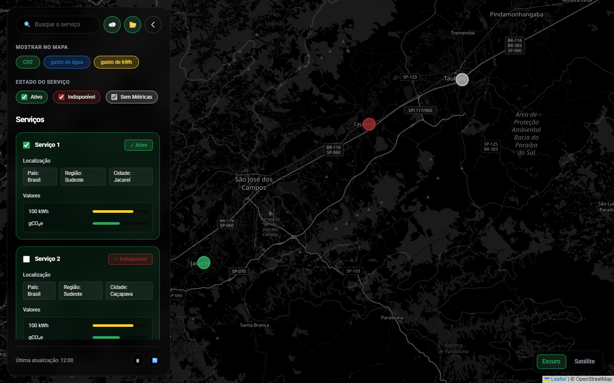

# Interface e experiência de uso

Em 06/11/2026, a `main` já reunia login, cadastro, painel administrativo e mapa. No build testado, era possível abrir essas telas e explorar os exemplos mesmo com o backend desligado. A integração do dashboard com as coletas reais continua pendente. [Versão verificada](https://github.com/404NotFound-ABP/greener/commit/1e075b9d2d0a0e2b8dbe396c6121a56057cbc4e1) · [Inventário da interface em 19/10](https://github.com/404NotFound-ABP/greener/blob/f755109253ed1fa11fd74a5a803e2c4862cd4360/docs/interface.md)

## Perfis e tarefas

| Quem usa | Tarefa | Fluxo atual |
|---|---|---|
| Pessoa que acompanha o ambiente | Localizar um serviço, reconhecer o estado e consultar energia, emissão e horário da leitura | Login → mapa, filtros, cards e modal com exemplos locais |
| Responsável pelo monitoramento | Autenticar-se e alterar os intervalos de coleta e de atualização da tela | O login administrativo abre um painel de perfis simulados. A configuração protegida dos intervalos está prevista na [Sprint 3](sprints/sprint-3.md). |

O cadastro percorre três telas e termina no mapa. O teste com e-mail fictício e senha arbitrária abriu tanto o mapa pelo login comum quanto o painel pelo login administrativo. As transições são controladas pelo estado do React. O aceite de autenticação e cadastro depende de chamadas à API e de uma sessão válida. [Navegação entre telas](../frontend/src/App.tsx)

## Figma e estilos implementados

O cliente reconheceu as seções de login, mapas/menus, configurações, exceções e mobile. Pediu evidências que permitam comparar os componentes do Figma com o resultado em tela. Em 06/11 a página do Figma respondeu HTTP 200 na rechecagem após um 403 na primeira consulta. Ainda é preciso confirmar que o avaliador consegue ver os frames do protótipo. [Protótipo no Figma](https://www.figma.com/design/zPrdeRlYtzyWwmbuTiwQqE/GeenER?node-id=0-1)

| Elemento | Referência encontrada no código |
|---|---|
| Tipografia | Família Roboto. A folha de estilo define títulos de 20, 24, 32 e 40 px, texto de 14, 16 e 18 px e legenda de 12 px. [Escala tipográfica](../frontend/src/index.css) |
| Cor e identificação dos estados | O modal associa verde `#2FA862` a “✓ Ativo”, vermelho `#9C2A2A` a “✕ Indisponível” e cinza a “─ Sem métricas”. No mapa, círculos coloridos representam os serviços e o texto aparece ao abrir o marcador. [Modal](../frontend/src/components/ServiceModal.tsx) · [Mapa](../frontend/src/components/MapBackground.tsx) |
| Espaçamento e adaptação | No login, os botões se empilham em telas estreitas e passam a uma linha a partir do breakpoint `sm`. A sidebar do mapa usa a largura fixa `w-96` e o espaçamento interno `p-5`. [Login](../frontend/src/pages/LoginPage.tsx) · [Sidebar](../frontend/src/components/Sidebar.tsx) |

## Capturas do dashboard

Capturas reais do build de produção de `1e075b9`, feitas em 06/11/2026 com a barra lateral aberta e os três filtros de estado selecionados. A mesma tela foi aberta no Chrome em dois tamanhos de janela, com escala de pixels 1. Os mapas de fundo carregaram nas duas capturas. Os serviços e os indicadores visíveis são dados de exemplo do frontend.

| [Desktop · 1440 × 900](evidencias/sprint-2/dashboard-desktop.png) | [Celular · 360 × 800](evidencias/sprint-2/dashboard-mobile.png) |
|---|---|
| A lista e o mapa cabem lado a lado. | A barra lateral de 384 px começa a 16 px da borda, levando o conteúdo a 400 px de largura. O botão de recolher fica cortado, e o seletor de tema cobre parte do rodapé. |

A comparação com o Figma depende de identificar o frame correspondente. Usar estas capturas como referência anterior aos ajustes e repetir o registro na versão corrigida.

## Indicadores

| O que conferir | Observado em 06/11 | Aceite da integração |
|---|---|---|
| Energia e emissão | Os dois cards mostram 100 kWh e a unidade gCO₂e sem número. O modal apresenta gráfico ilustrativo e variação fixa no serviço ativo. | Exibir a energia em kWh e a emissão em gCO₂e para a mesma leitura do banco, com o período. Sinalizar o resultado indisponível quando faltar uma entrada necessária. |
| Última atualização | O rodapé mostra sempre 12:00. Os controles de pausa e atualização são visuais. | Informar o horário da última coleta válida e o intervalo de atualização. Após uma falha, identificar os dados antigos até a próxima resposta válida. |
| Disponibilidade e localização | Há três marcadores locais e dois cards em outra lista, também local. O modal representa ativo, indisponível e sem métricas. | Usar o mesmo ID e estado na lista, no mapa e no detalhe. Manter acessíveis pela lista os serviços sem coordenadas. |
| Água | Há um controle ilustrativo “gasto de água”. | Confirmar com a PO o destino do controle. O escopo ambiental do desafio abrange energia e emissão. |

As medidas coletadas pelo backend podem ser verificadas pela API. Para o aceite do dashboard, comparar no banco, na API e na tela o mesmo serviço e a mesma leitura. [Contrato da API](api.md) · [Cálculos ambientais](calculos.md)

## Teste de interface e avaliação de usabilidade

O teste técnico de 06/11 usou o build de produção no navegador. Os resultados abaixo registram comportamentos reproduzidos e os critérios para o próximo teste.

| Como reproduzir | Resultado observado | O que verificar após a correção |
|---|---|---|
| No mapa, digitar um nome de serviço inexistente. | Os dois cards continuam visíveis. | A busca deve filtrar a lista e apresentar um estado vazio quando nenhum serviço corresponder. |
| Manter marcado somente “Sem Métricas”. | Um marcador permanece visível e a lista mostra “Nenhum serviço encontrado”. | O mesmo serviço deve aparecer no filtro da lista e do mapa. |
| Abrir o mapa com a sidebar visível em uma janela de 360 × 800 px. | Há rolagem horizontal, controles cortados à direita e o seletor de tema se sobrepõe ao rodapé. | Buscar, filtrar, fechar a sidebar e consultar a atualização sem controles encobertos. Comparar o resultado, no celular e no desktop, com as capturas de 06/11. |

No fluxo integrado, testar ainda carregamento, lista realmente vazia, erro da API, recuperação e ausência de métricas. Verificar texto ou ícone para cada estado, contraste, navegação por teclado e nomes acessíveis dos botões de ícone. [Lista e falhas](https://github.com/404NotFound-ABP/greener/issues/94) · [Adaptação do dashboard ao celular](https://github.com/404NotFound-ABP/greener/issues/146)

A [tarefa de avaliação](https://github.com/404NotFound-ABP/greener/issues/41) constava como fechada em 06/11. Para comprovar o critério de usabilidade, vincular o roteiro aplicado, a data, os perfis participantes, as dificuldades observadas e os ajustes com evidências de antes/depois. A verificação técnica descrita acima cobre apenas o comportamento da interface.
